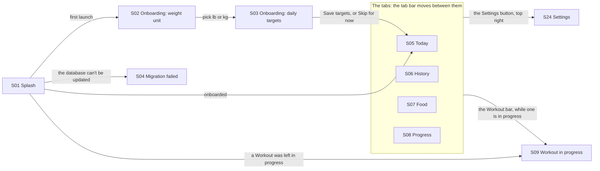
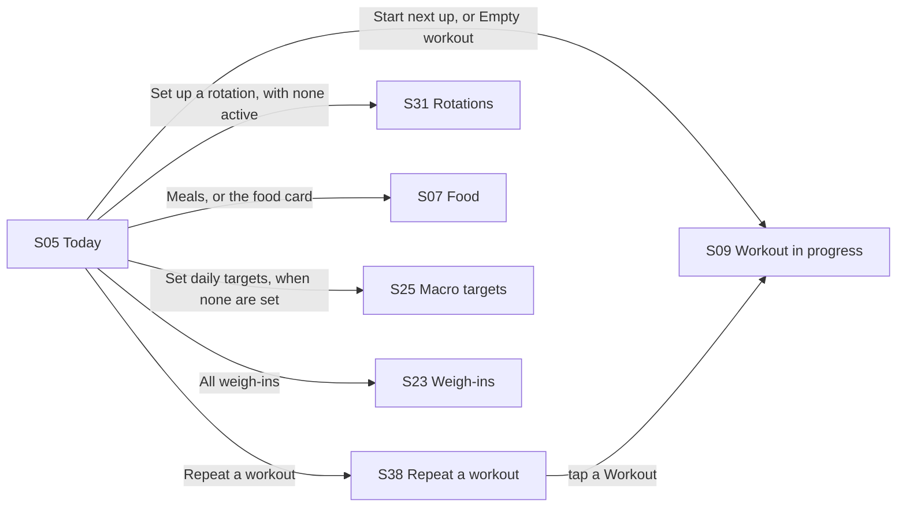
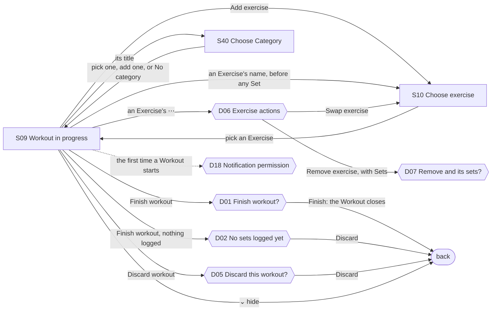
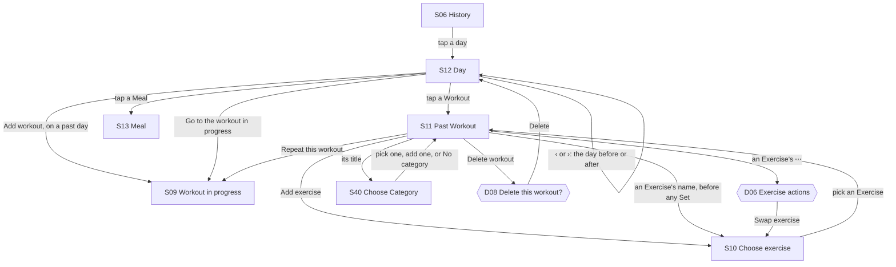
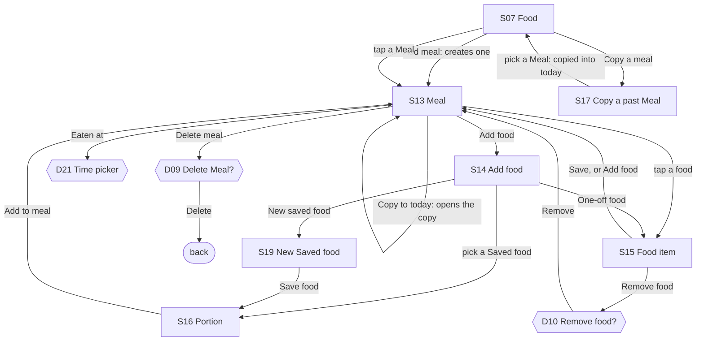
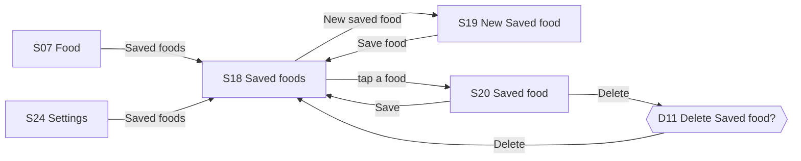
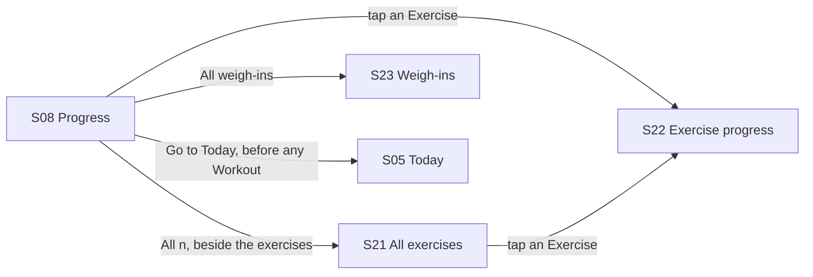
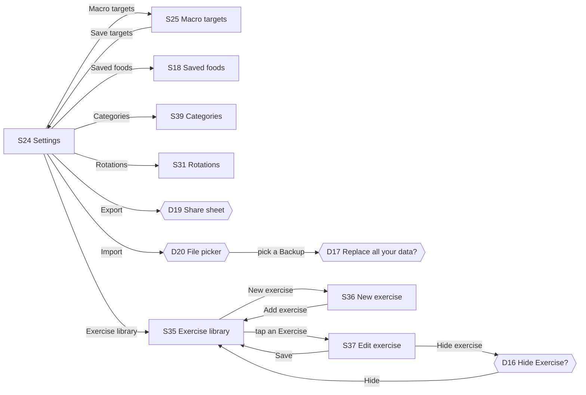
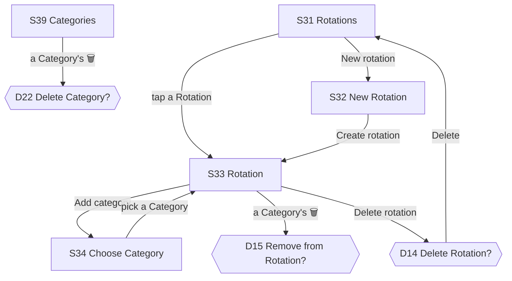

# User flows

Every screen in Notch has an ID, `S01` to `S40`, and every dialog one from `D01` to `D22`. Use them to name a screen in an issue, a PR or a conversation: "S12's › button" says exactly where.

IDs are permanent. A new screen or dialog takes the next free number, and a removed one's ID is retired, never reused: the retired ones are listed under each table. When a change adds, removes or reconnects a screen or dialog, update this file in the same change.

## Screens

| ID | Screen | Route | File |
|---|---|---|---|
| S01 | Splash | (launch) | `src/app/_layout.tsx` |
| S02 | Onboarding: weight unit | `/onboarding`, step 1 | `src/app/onboarding.tsx` |
| S03 | Onboarding: daily targets | `/onboarding`, step 2 | `src/app/onboarding.tsx` |
| S04 | Migration failed | (launch) | `src/app/_layout.tsx` |
| S05 | Today tab | `/` | `src/app/(tabs)/index.tsx` |
| S06 | History tab | `/history` | `src/app/(tabs)/history.tsx` |
| S07 | Food tab | `/food` | `src/app/(tabs)/food.tsx` |
| S08 | Progress tab | `/progress` | `src/app/(tabs)/progress.tsx` |
| S09 | Workout in progress | `/workout` | `src/app/workout/index.tsx` |
| S10 | Choose exercise: add to or swap in a Workout | `/workout/choose-exercise` | `src/app/workout/choose-exercise.tsx` |
| S11 | Past Workout | `/workout/[id]` | `src/app/workout/[id].tsx` |
| S12 | Day | `/day/[date]` | `src/app/day/[date].tsx` |
| S13 | Meal | `/meals/[id]` | `src/app/meals/[id].tsx` |
| S14 | Add food: choose how | `/meals/choose-food` | `src/app/meals/choose-food.tsx` |
| S15 | Food item: add a one-off, or edit | `/meals/food-item` | `src/app/meals/food-item.tsx` |
| S16 | Portion of a Saved food | `/meals/portion` | `src/app/meals/portion.tsx` |
| S17 | Copy a past Meal | `/meals/choose-past-meal` | `src/app/meals/choose-past-meal.tsx` |
| S18 | Saved foods | `/saved-foods` | `src/app/saved-foods/index.tsx` |
| S19 | New Saved food | `/saved-foods/new` | `src/app/saved-foods/new.tsx` |
| S20 | Saved food | `/saved-foods/[id]` | `src/app/saved-foods/[id].tsx` |
| S21 | All exercises with progress | `/progress/all` | `src/app/progress/all.tsx` |
| S22 | Exercise progress chart | `/progress/[exerciseId]` | `src/app/progress/[exerciseId].tsx` |
| S23 | Weigh-ins | `/weigh-ins` | `src/app/weigh-ins.tsx` |
| S24 | Settings | `/settings` | `src/app/settings.tsx` |
| S25 | Macro targets | `/macro-targets` | `src/app/macro-targets.tsx` |
| S31 | Rotations | `/rotations` | `src/app/rotations/index.tsx` |
| S32 | New Rotation | `/rotations/new` | `src/app/rotations/new.tsx` |
| S33 | Rotation | `/rotations/[id]` | `src/app/rotations/[id].tsx` |
| S34 | Choose Category for a Rotation | `/rotations/choose-category` | `src/app/rotations/choose-category.tsx` |
| S35 | Exercise library | `/exercises` | `src/app/exercises/index.tsx` |
| S36 | New exercise | `/exercises/new` | `src/app/exercises/new.tsx` |
| S37 | Edit exercise | `/exercises/[id]` | `src/app/exercises/[id].tsx` |
| S38 | Repeat a workout | `/workout/repeat` | `src/app/workout/repeat.tsx` |
| S39 | Categories | `/categories` | `src/app/categories/index.tsx` |
| S40 | Choose Category for a Workout | `/workout/category` | `src/app/workout/category.tsx` |

Retired with Templates: S26 Templates, S27 New Template or Save as template, S28 Template, S29 Choose exercise for a Template, S30 Target.

A screen opened for a record that's gone (a deleted Meal, Rotation or Workout) shows that instead of its content, and S12 shows "No such date." for a date that isn't real. These are states of the screen, not screens of their own.

## Dialogs

| ID | Dialog | Shown on | Choices |
|---|---|---|---|
| D01 | Finish workout? | S09, Finish workout | Finish: the Workout finishes and closes, back to the screen underneath. Cancel: stays. |
| D02 | No sets logged yet | S09, Finish workout with nothing logged | Discard: the Workout is discarded, back. Keep going: stays. |
| D05 | Discard this workout? | S09, Discard workout | Discard: back. Keep it: stays. |
| D06 | Exercise actions (bottom sheet) | S09, S11: an Exercise's ⋯ | Swap exercise (before any Set is logged): S10. Remove exercise: D07, or removed at once with no Sets. |
| D07 | Remove *Exercise* and its *n* sets? | D06, Remove exercise | Remove or Cancel; stays. |
| D08 | Delete this workout? | S11, Delete workout | Delete: back. |
| D09 | Delete *Meal*? | S13, Delete meal | Delete: back. |
| D10 | Remove *food*? | S15, Remove food | Remove: back to S13. |
| D11 | Delete *Saved food*? | S20, Delete | Delete: back. |
| D14 | Delete *Rotation*? | S33, Delete rotation | Delete: back. |
| D15 | Remove *Category* from *Rotation*? | S33, a Category's 🗑 | Remove; stays. |
| D16 | Hide *Exercise*? | S37, Hide exercise | Hide: back. |
| D17 | Replace all your data? | S24, Import, after a file is picked | Replace: the Backup replaces everything. |
| D18 | Notification permission (Android) | the first time a Workout starts | Allow or Don't allow; the in-app rest timer works either way. |
| D19 | Share sheet (Android) | S24, Export | Save or send the Backup file. |
| D20 | File picker (Android) | S24, Import | Pick a Backup file: D17. |
| D21 | Time picker (Android) | S13, Eaten at | Moves the Meal within its day. |
| D22 | Delete *Category*? | S39, a Category's 🗑 | Delete: its Workouts stay in History, in no Category; stays. |

Retired with Templates: D03 Update Template?, D04 Raise the target?, D12 Delete Template?, D13 Remove from Template?

Any command can be refused. A "Couldn't …" alert then says why, and the screen stays as it was.

## How the screens connect

Each diagram covers one area. A screen from another area appears with its ID, and its own diagram carries on from there. "back" returns to the screen underneath.

### Launch and the tabs

Tapping the "Rest over" notification brings the app back where it was. If the app had been closed, it opens on S09.

### Today

Today's Weigh-in is entered on S05 itself.

### Working out

S09 opens from S01, S05, S11, S12, S38 and the Workout bar on any tab, and "back" returns there, or to S05 after S38, whose place the Workout takes. The dotted line is a question that comes up on its own. Nothing is asked after a Workout finishes.

### History

### Meals

S14 gives way to the screen picked from it, so S15, S16 and S19 return straight to S13. A deleted Meal goes back to where it was opened: S07 or S12.

### Saved foods

S19 opened from S14, while adding to a Meal, goes on to S16 for the amount instead of back to S18.

### Progress

### Settings and the Exercise library

S25 returns to whichever screen opened it: S05 or S24. Changing the weight unit, and an Exercise's rest length and rep range, happen on the screen itself.

### Categories and Rotations

A Category is made where it's used, by naming a Workout on S40, so S39 only renames and deletes. Renaming a Category or Rotation, reordering and switching a Rotation on happen on the screen itself.
